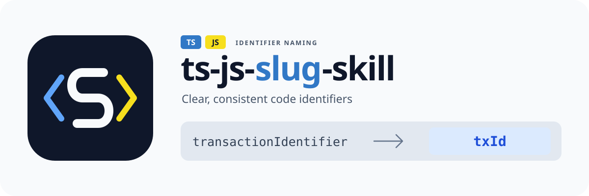

# ts-js-slug-skill

<p align="center">
  
</p>

[简体中文](README.zh-CN.md) | [English](README.md)

An agent skill for clear, consistent TypeScript and JavaScript identifier naming. Business meaning and protocol terminology come first; the shared dictionary (`temporary` → `tmp`, `context` → `ctx`, `format` → `fmt`) supplies optional candidates for names that can be shortened without losing clarity. Works with Claude Code, Codex, and agents supported by the [skills CLI](https://github.com/vercel-labs/skills).

Naming guidance covers browser and Node.js code, including JSX/TSX. Prefer recognizable TS/JS abbreviations when they preserve clarity. The name-suggestion helper performs dictionary lookups; existing code uses the TypeScript/JavaScript language service or IDE semantic rename. The bundled AST rename helper supports TypeScript projects.

## Name and Logo

`ts-js-slug-skill` names its TypeScript/JavaScript scope explicitly. “Slug” represents a compact, readable identifier, and “skill” describes the reusable naming guidance for coding agents. It preserves meaning and project conventions when shortening eligible local technical names, such as `temporaryBufferLength` → `tmpBufLen`.

The logo places a white **S** for `slug` between blue TypeScript and yellow JavaScript code brackets. The `TS`/`JS` labels identify the supported languages. Its `transactionIdentifier` → `txId` example illustrates a possible local technical abbreviation; business entity names such as `BillingTransaction` retain their full meaning. The [SVG logo](assets/ts-js-slug-skill-logo.svg) and [square icon](assets/ts-js-slug-skill-icon.svg) scale without losing detail.

## Install

Install the skill from GitHub:

```bash
npx skills add aShu-guo/ts-js-slug-skill --skill ts-js-slug-skill
```

Or use the npm installer to select Claude Code/Codex and project/global scope interactively:

```bash
npx ts-js-slug-skill
```

| Agent       | Project path                         | Global path                          |
| ----------- | ------------------------------------ | ------------------------------------ |
| Claude Code | `./.claude/skills/ts-js-slug-skill/` | `~/.claude/skills/ts-js-slug-skill/` |
| Codex       | `./.agents/skills/ts-js-slug-skill/` | `~/.codex/skills/ts-js-slug-skill/`  |

Reinstalling preserves existing `config/default.config.json` and `dictionary/default.json`. Use project scope to share conventions with your team.

## Naming Priority

Choose the business or protocol term before considering project style and dictionary candidates. Follow formal domain names and preserve canonical acronyms such as `HTTP`, `OAuth`, and `SQL`. A dictionary match does not require a change; retain the full name whenever abbreviation would obscure its meaning.

Types shared across modules, API resources, and database tables retain business qualifiers and full entity terms. Local names may omit a redundant qualifier when the enclosing function, types, and nearby usages identify the concept unambiguously:

| Context                                           | Naming decision                                                               |
| ------------------------------------------------- | ----------------------------------------------------------------------------- |
| Shared business type                              | Keep `BillingTransaction`                                                     |
| API resource / database table                     | Keep `/billing-transactions` / `billing_transactions`                         |
| Local binding in an unambiguous billing operation | `billingTransaction` may become `transaction`, keeping the full business noun |
| Billing and refund transactions used together     | Keep `billingTransaction` and `refundTransaction`                             |

Scope settings and project overrides remain subject to these rules. Even `exported: true` only expands candidate eligibility. Renaming an existing public contract requires an explicit business refactoring goal and a compatibility plan. The [skill instructions](skills/ts-js-slug-skill/SKILL.md#meaning-and-boundaries-first) define the full decision rules.

## TypeScript and JavaScript Naming

These are mechanical candidates for eligible local technical names after semantic review. The PascalCase example also requires local classes to be enabled in scope.

| Naming style                          | Before                             | Candidate            |
| ------------------------------------- | ---------------------------------- | -------------------- |
| camelCase                             | `temporaryBufferLength`            | `tmpBufLen`          |
| PascalCase (local class when enabled) | `TemporaryBuffer`                  | `TmpBuf`             |
| snake_case (project convention)       | `temporary_buffer`                 | `tmp_buf`            |
| SCREAMING_SNAKE_CASE                  | `MAXIMUM_BUFFER_LENGTH`            | `MAX_BUF_LEN`        |
| Identifier prefixes                   | `$configuration`, `_configuration` | `$config`, `_config` |
| Acronyms                              | `HTTPContext`                      | `HTTPCtx`            |

Match whole word segments, preserve separators/case, and leave unmatched words intact. Check TS/JS keywords, built-ins, and scope collisions before using a suggestion. For example, `variable` → `var` is invalid as a complete binding name, while `variableCount` → `varCount` is valid. Keep external APIs such as `document`, `.length`, and `.toString()` intact; only eligible local declarations and their references are candidates for renaming.

For new code, review every declaration for required semantic content, boundary qualifications, and scope eligibility, including intermediate locals and loop bindings. For existing code, select the name using the same rules, then use a semantic rename tool and run the repository's configured type checks, lint, and relevant tests. See the [skill instructions](skills/ts-js-slug-skill/SKILL.md) and [TS/JS tooling reference](skills/ts-js-slug-skill/references/language-tooling.md).

## Built-in Dictionary

The dictionary covers general programming, collections, networking, security, storage, tooling, graphics, and units. Singular/plural forms are explicit mappings.

| Full word                          | Abbreviation       |
| ---------------------------------- | ------------------ |
| business / context / configuration | biz / ctx / config |
| parameter / parameters             | param / params     |
| request / response                 | req / resp         |
| buffer / length                    | buf / len          |
| dictionary / dictionaries          | dict / dicts       |
| error / errors                     | err / errs         |
| authentication / authorization     | auth / authz       |
| transaction / transactions         | tx / txs           |
| organization / department          | org / dept         |
| latitude / longitude               | lat / lng          |
| notification / notifications       | notif / notifs     |
| vector / matrix                    | vec / mat          |

The authoritative built-in candidates are in [dictionary/default.json](skills/ts-js-slug-skill/dictionary/default.json); mechanical examples and tests follow that file. An entry does not authorize changing a business or protocol term. Words absent from the resolved dictionary remain unchanged. Some words share an abbreviation; keep the full name when the shorter form would obscure meaning or collide in the target scope.

Candidate mappings include `configuration/configurations` → `config/configs`, `development` → `dev`, `synchronous` → `sync`, `number` → `num`, and `format` → `fmt`. Existing `config`, `formatter`, and `formatters` stay unchanged. Keep `developer`, `synchronize`, `synchronization`, `numeric`, `subscriber`, and `subscription` in full, along with their plural forms.

## Customize

Edit `<skill-dir>/config/default.config.json` to choose eligible identifier kinds:

```json
{ "scope": ["variable", "parameter"], "exported": false }
```

`scope` accepts `variable`, `parameter`, `localFunction`, and `class`. `exported` controls whether public/exported symbols may be considered and defaults to `false`. These settings do not override semantic requirements or authorize changes to existing public contracts.

Add a flat dictionary override at the target repository root as `.ts-js-slug-skill.local.json`:

```json
{
  "warehouse": "wh",
  "customer": "cust"
}
```

Entries in `.ts-js-slug-skill.local.json` merge over built-in defaults; this is the only project override filename. Override files contain word mappings only; scope stays in the skill config.

## Bundled Scripts

Installation copies these optional helpers into the skill directory; it does not run them automatically.

| Script                            | Purpose                                                                                                                   | Writes source files |
| --------------------------------- | ------------------------------------------------------------------------------------------------------------------------- | ------------------- |
| `scripts/suggest-name.ts`         | Merge dictionaries and print mechanical candidates with binding syntax checks; semantic review remains with the agent     | No                  |
| `scripts/rename-with-ts-morph.ts` | Rename local TypeScript bindings and references, preserving shorthand keys and import/export specifier names with aliases | Yes                 |

The rename helper requires resolvable `ts-morph` and `tsx` dependencies and a target `tsconfig.json`. See the [tooling reference](skills/ts-js-slug-skill/references/language-tooling.md) for invocation and dependency setup. Scope eligibility and public API review remain the caller's responsibility.

## Suggest Names

The optional helper requires Node.js and `tsx`. It reads dictionaries and prints suggestions without editing source files:

```bash
npx tsx <skill-dir>/scripts/suggest-name.ts --repo /path/to/project \
  temporaryBufferLength httpContext MAXIMUM_BUFFER_LENGTH
```

```text
temporaryBufferLength -> tmpBufLen
httpContext -> httpCtx
MAXIMUM_BUFFER_LENGTH -> MAX_BUF_LEN
```

The helper handles ASCII identifiers and conservatively leaves non-ASCII names and names enclosed in double underscores unchanged. It checks each complete candidate's identifier syntax and rejects reserved or restricted binding names under strict/module conventions, falling back to the original name. For example, `variable` stays `variable`, while `variableCount` becomes `varCount`. It has no business or protocol context and cannot judge whether a qualifier is redundant. It also does not inspect source scope, built-ins, or collisions. The agent must review candidates in their source context; the helper does not automatically remove business qualifiers or approve a rename.

## Update an Installation

Reinstall `ts-js-slug-skill` in the same agent/scope to update skill instructions and scripts. Existing protected configurations and dictionaries are preserved; merge updated built-in entries manually if you customized those files. Store project overrides in `.ts-js-slug-skill.local.json`.

## Development

```bash
npm ci
npm test
npm run typecheck
npm run lint
npm run build
node dist/cli.js
```

For local skill-content iteration, link the skill folder directly:

```bash
ln -sfn /path/to/ts-js-slug-skill/skills/ts-js-slug-skill \
  your-test-project/.claude/skills/ts-js-slug-skill
```

Source: [aShu-guo/ts-js-slug-skill](https://github.com/aShu-guo/ts-js-slug-skill). npm: [ts-js-slug-skill](https://www.npmjs.com/package/ts-js-slug-skill).

## Publish to npm

| Command                   | Effect                                                        |
| ------------------------- | ------------------------------------------------------------- |
| `npm run publish:dry-run` | Validate, build, and preview the package without uploading it |
| `npm run publish:npm`     | Publish the current version publicly to the npm registry      |

Both commands run type checking, lint, formatting checks, tests, and the build through `prepublishOnly`. Run `npm run verify` to perform the checks independently.

## License

MIT
