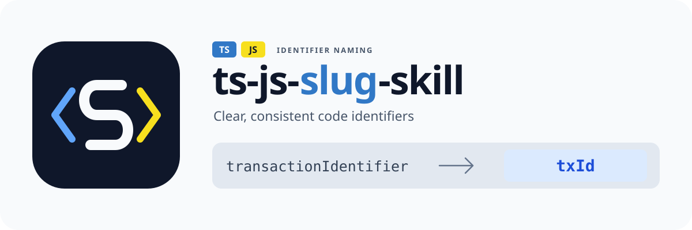

# ts-js-slug-skill

<p align="center">
  
</p>

[简体中文](README.zh-CN.md) | [English](README.md)

一个面向 TypeScript 和 JavaScript 的 Agent Skill，使用共享缩写词典（`business` → `biz`、`context` → `ctx`、`configuration` → `config`）统一标识符命名，优先保证含义清晰，同时保留项目命名风格和公共契约。支持 Claude Code、Codex，以及 [skills CLI](https://github.com/vercel-labs/skills) 支持的其他 agent。

命名规则覆盖浏览器和 Node.js 代码，包括 JSX/TSX；仅在含义清晰时采用 TS/JS 生态中容易识别的缩写。名称建议脚本负责词典查找，已有代码使用 TypeScript/JavaScript 语言服务或 IDE 进行语义重命名。内置 AST 重命名脚本适用于 TypeScript 项目。

## 名称与 Logo 含义

`ts-js-slug-skill` 中的 `ts-js` 明确 TypeScript/JavaScript 定位，`slug` 表达“简短、可读的标识符”，`skill` 表示提供给编程 agent 的可复用命名技能。缩写时保留含义和项目命名风格，例如 `businessContext` → `bizCtx`、`business_context` → `biz_ctx`。

Logo 以代表 `slug` 的白色 **S** 为中心，两侧代码括号分别使用 TypeScript 蓝和 JavaScript 黄。`TS`/`JS` 标签标明支持的语言，`transactionIdentifier` → `txId` 展示词典的作用。提供可无损缩放的 [SVG 横版 Logo](assets/ts-js-slug-skill-logo.svg) 和 [方形图标](assets/ts-js-slug-skill-icon.svg)。

## 安装

更新后的技能推送到源仓库后，可通过以下命令安装：

```bash
npx skills add aShu-guo/ts-abbr-skill --skill ts-js-slug-skill
```

npm 包发布后，也可通过交互式安装器选择 Claude Code/Codex、项目级/全局安装位置：

```bash
npx ts-js-slug-skill
```

| Agent       | 项目级路径                           | 全局路径                             |
| ----------- | ------------------------------------ | ------------------------------------ |
| Claude Code | `./.claude/skills/ts-js-slug-skill/` | `~/.claude/skills/ts-js-slug-skill/` |
| Codex       | `./.agents/skills/ts-js-slug-skill/` | `~/.codex/skills/ts-js-slug-skill/`  |

重复安装会保留已有的 `config/default.config.json` 和 `dictionary/default.json`。团队共享命名约定时可选择项目级安装。

## TypeScript 和 JavaScript 命名

| 命名风格                     | 原名                               | 缩写后               |
| ---------------------------- | ---------------------------------- | -------------------- |
| camelCase                    | `businessContext`                  | `bizCtx`             |
| PascalCase（配置纳入范围时） | `BusinessContext`                  | `BizCtx`             |
| snake_case（遵循项目约定）   | `business_context`                 | `biz_ctx`            |
| SCREAMING_SNAKE_CASE         | `MAXIMUM_BUFFER_LENGTH`            | `MAX_BUF_LEN`        |
| 标识符前缀                   | `$configuration`、`_configuration` | `$config`、`_config` |
| 首字母缩略词                 | `HTTPResponse`                     | `HTTPResp`           |

只替换完整单词片段，保留分隔符和大小写，不改未匹配的单词。使用候选名称前检查 TS/JS 关键字、内置名称和作用域冲突。例如 `variable` → `var` 不能用作完整绑定名，而 `variableCount` → `varCount` 合法。保留 `document`、`.length`、`.toString()` 等外部 API，仅对范围内的本地声明及其引用进行重命名。

生成新代码时，逐一检查范围内的声明，包括中间变量、循环变量。重构已有代码时使用语义重命名，并执行目标仓库配置的类型检查、lint 和相关测试。详见 [技能规则](skills/ts-js-slug-skill/SKILL.md) 和 [TS/JS 工具参考](skills/ts-js-slug-skill/references/language-tooling.md)。

## 内置缩写清单

词典覆盖通用编程、集合、网络、安全、存储、开发工具、图形和单位。单复数分别列出，不自动猜测复数形式。

| 全称                               | 缩写               |
| ---------------------------------- | ------------------ |
| business / context / configuration | biz / ctx / config |
| parameter / parameters             | param / params     |
| request / response                 | req / resp         |
| buffer / length                    | buf / len          |
| dictionary / dictionaries          | dict / dicts       |
| error / errors                     | err / errs         |
| authentication / authorization     | auth / authz       |
| transaction / transactions         | tx / txs           |
| organization / department          | org / dept         |
| latitude / longitude               | lat / lng          |
| notification / notifications       | notif / notifs     |
| vector / matrix                    | vec / mat          |

内置映射以 [dictionary/default.json](skills/ts-js-slug-skill/dictionary/default.json) 为准，示例和测试随词典同步。合并后的词典未收录的单词保持原样。部分词条存在相同缩写；当缩写造成歧义或同作用域冲突时，保留完整名称。

`configuration/configurations` 使用 `config/configs`，已有的 `config` 保持原样。`dev`、`sync`、`num` 分别表示 `development`、`synchronous`、`number`；`developer`、`synchronize`、`synchronization`、`numeric`、`format`、`formatter`、`subscriber`、`subscription` 及其复数形式保留完整词。

## 自定义

修改 `<skill-dir>/config/default.config.json`，调整生效范围：

```json
{ "scope": ["variable", "parameter"], "exported": false }
```

`scope` 可选 `variable`、`parameter`、`localFunction`、`class`；`exported` 控制公共/导出符号，默认 `false`。

在目标仓库根目录添加 `.ts-js-slug-skill.local.json`，配置项目专属缩写：

```json
{
  "warehouse": "wh",
  "customer": "cust"
}
```

词条合并覆盖内置词典，并兼容两个旧配置文件名。优先级为内置词典 < `.ts-abbr-skill.local.json` < `.slug-skill.local.json` < `.ts-js-slug-skill.local.json`。覆盖文件只存单词映射，范围配置仍放在技能配置文件中。

## 内置辅助脚本

安装器会将以下可选脚本复制到技能目录，不会自动执行。

| 脚本                              | 用途                                                                                 | 是否修改源文件 |
| --------------------------------- | ------------------------------------------------------------------------------------ | -------------- |
| `scripts/suggest-name.ts`         | 合并词典，生成合法的本地绑定名建议                                                   | 否             |
| `scripts/rename-with-ts-morph.ts` | 重命名本地 TypeScript 绑定及其引用，通过别名保留简写对象键和导入导出列表中的外部名称 | 是             |

重命名脚本需要可解析的 `ts-morph`、`tsx` 依赖及目标项目的 `tsconfig.json`。调用方法和依赖设置见 [工具参考](skills/ts-js-slug-skill/references/language-tooling.md)。调用方仍需检查作用范围和公共 API。

## 名称建议脚本

可选脚本需要 Node.js 和 `tsx`，只读取词典并输出建议，不修改源文件：

```bash
npx tsx <skill-dir>/scripts/suggest-name.ts --repo /path/to/project \
  businessContext business_context MAXIMUM_BUFFER_LENGTH
```

```text
businessContext -> bizCtx
business_context -> biz_ctx
MAXIMUM_BUFFER_LENGTH -> MAX_BUF_LEN
```

脚本处理 ASCII 标识符，保守地保持非 ASCII 名称及两端带双下划线的名称原样。脚本检查完整候选的标识符语法，并按严格模式和模块约定排除保留字及受限绑定名；检查不通过时回退原名。例如 `variable` 保持原样，`variableCount` 缩写为 `varCount`。脚本不检查源码作用域、内置名称或冲突，agent 仍需结合源码审核建议。

## 从 ts-abbr-skill 或 slug-skill 迁移

在相同 agent 和安装范围内安装 `ts-js-slug-skill`，按需复制旧技能目录中自定义的配置和词典，再移除旧安装，避免同时加载两个技能。安装器创建新目录，不会自动迁移或删除旧安装。重复安装会保留受保护词典；如果曾直接修改该文件，需要手动合并更新后的内置词条。

## 本地开发

```bash
npm ci
npm test
npm run typecheck
npm run lint
npm run build
node dist/cli.js
```

调试技能内容时可直接链接技能目录：

```bash
ln -sfn /path/to/ts-js-slug-skill/skills/ts-js-slug-skill \
  your-test-project/.claude/skills/ts-js-slug-skill
```

当前源仓库为 `aShu-guo/ts-abbr-skill`。GitHub 远程仓库改名和 npm 发布属于独立的发布操作，修改本地元数据不会执行这两项操作。

## 发布到 npm

| 命令                      | 作用                                    |
| ------------------------- | --------------------------------------- |
| `npm run publish:dry-run` | 执行校验、构建和打包预演，不上传包      |
| `npm run publish:npm`     | 将当前版本以公开方式发布到 npm registry |

两个命令都会通过 `prepublishOnly` 执行类型检查、lint、格式检查、测试和构建。也可单独运行 `npm run verify` 执行校验。

## License

MIT
